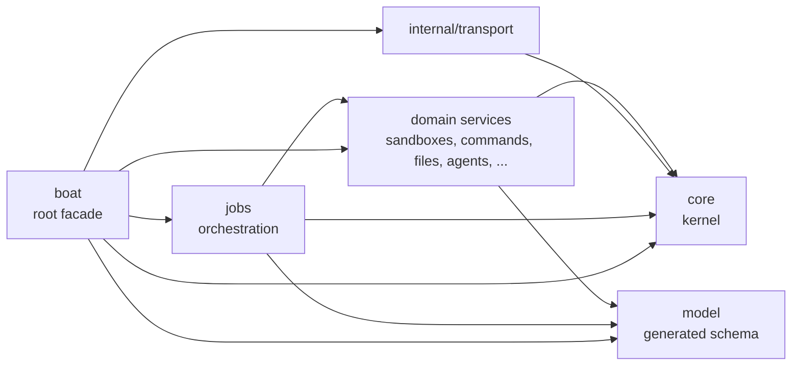

# Architecture

Status: implementation started. The kernel, transport, generated `model` package, root facade and
the `sandboxes` service exist. The remaining domain services are in progress. This document
describes the target architecture and the rules that keep it maintainable as the SDK grows.

## 1. Context

This is an unofficial Go client for the Boat public API v1. The TypeScript and Python SDKs are the
reference for **capabilities**, not for structure. The Go SDK should feel native to Go:

- `context.Context` on every I/O call
- errors returned, not thrown
- concrete services, small interfaces at seams
- no reflection-heavy generated client exposed to users
- streaming via explicit readers/iterators, not buffered JSON

The OpenAPI spec (<https://docs.boat.dev/openapi/boat-v1.yaml>) is the source of truth for request
and response schemas. The hand-written facade is the source of truth for ergonomics.

## 2. Goals and non-goals

**Goals**

- Full coverage of the v1 API over time, starting with sandboxes and commands.
- Small, composable domain packages with an acyclic dependency graph.
- One transport implementation with consistent auth, retries, errors and pagination.
- Testable without a Boat account or network access.
- Documentation that can be trusted by an integrator.

**Non-goals**

- A CLI, server, desktop stream client or agent runtime.
- Reimplementing the official API reference.
- Exposing the generated raw HTTP client or internal generated code as the public contract.
  (`model` is public and semver-covered; see §15.)
- Supporting dashboard-only features such as billing, wallet, seats or plan changes.

## 3. Why domain packages

A single `boat` package is simpler and is a valid choice for a small internal SDK. This repository
targets a public, growing SDK, so the design uses domain packages:

- smaller public surfaces per package
- clear ownership and review boundaries
- domains can be extracted or versioned later
- tests and docs stay close to the service

The cost is import-cycle risk and more ceremony. The dependency rules in §4 are the mitigation.

## 4. Package graph

Arrows point toward dependencies: `A → B` means **A imports B**.



The canonical dependency table lives in [AGENTS.md §4.2](../AGENTS.md#42-dependency-rules-canonical).
Do not duplicate it here; keep the graph above and the table in one place.

Services never call services. If two domains must cooperate, the workflow belongs in `jobs/`.

## 5. Core kernel

`core` holds the types every package needs and no domain logic.

```go
type Doer interface {
    Do(ctx context.Context, req *Request, out any, opts ...RequestOption) error
    DoRaw(ctx context.Context, req *Request, opts ...RequestOption) (*http.Response, error)
}

type Request struct {
    Method string
    Path   string
    Query  url.Values
    Header http.Header
    JSON   any       // marshalled once, reused on retries
    Body   io.Reader // one-shot; retries require a replayable body
}

type Config struct {
    BaseURL     string
    APIKey      string
    Org         string
    HTTPClient  HTTPClient
    TokenSource TokenSource
    UserAgent   string
    MaxRetries  int
    RetryMin    time.Duration
    RetryMax    time.Duration
}

type HTTPClient interface {
    Do(*http.Request) (*http.Response, error)
}

type TokenSource interface {
    Token(context.Context) (string, error)
}

type Stream[T any] interface {
    Next(ctx context.Context) (T, error) // io.EOF at the end
    Close() error
}

type Page[T any] struct {
    Items      []T
    NextCursor string
    HasMore    bool
}
```

`Do` is for JSON envelopes. `DoRaw` is for NDJSON, binary downloads and any response the caller
must stream or inspect directly.

## 6. Request lifecycle

1. A service builds a `core.Request` with method, path, query, headers and JSON/body.
2. `internal/transport` resolves the base URL, joins the path, encodes query values and marshals JSON.
3. It applies, in order:
   - `Authorization: Bearer <token>` unless the request opts out
   - `X-Boat-Org` when configured or supplied per request
   - `User-Agent`
   - `Idempotency-Key` when supplied
   - caller request editors / extra headers
4. It executes the request with `HTTPClient`.
5. Retry policy applies only to safe operations (see §8).
6. The envelope is decoded:
   - `ok: true` → decode the payload into `out`
   - `ok: false` → map to `*core.APIError`
   - non-JSON error body → generic error with status and a bounded body excerpt
7. `DoRaw` returns the response and leaves body ownership to the caller, with a helper for error
   mapping.

The transport is the only package that knows about HTTP status codes, `Retry-After`, rate-limit
headers and the envelope shape.

## 7. Error model

```go
type APIError struct {
    Status     int
    Code       string
    Message    string
    RequestID  string
    Details    map[string]any
    RetryAfter time.Duration
}
```

Rules:

- Preserve `requestId`; it is required for support.
- Expose `IsCode(err, code)` and `RetryAfter(err)` in the root package.
- Use `errors.As`/`errors.Is`; never match strings.
- Do not include secrets or signed URLs in error text.
- Distinguish retryable from terminal errors in the transport, not in each service.

## 8. Retries and rate limits

| Operation | Retry? |
|---|---|
| GET / list / read | Yes, on 429, 500, 502, 503, with jitter and `Retry-After` |
| Create / fork | Only with an `Idempotency-Key` |
| Stop / resume / delete | No automatic retry; surface the error |
| Command / prompt | Never; commands may already have run |
| File writes | Only when the caller explicitly asks for a retry |
| Streaming | Reconnect only where the protocol is resumable (documented attach/run behavior) |

Honor `RateLimit` and `RateLimit-Policy`. A refused start does not count against the account, but it
is still an error the caller must handle.

For create and fork, generate one UUID key per logical call, store it on the request, and reuse it
verbatim on every attempt. Default-on; callers may override it. Only retry a request when its body
is replayable (`JSON` or a body factory); never retry a one-shot `io.Reader`. Set
`core.Request.NoRetry` for non-idempotent calls (commands and process stops) so a caller-supplied
Idempotency-Key cannot turn them into retries.

## 9. Pagination

List endpoints return a cursor. Services expose typed pages:

```go
type SandboxPage = core.Page[model.Sandbox]

func (s *Service) List(ctx context.Context, req ListRequest) (SandboxPage, error)
```

A generic helper in the root or `core` package can turn a fetch function into an iterator. It must:

- stop when `HasMore` is false
- return an error immediately
- support context cancellation
- never loop forever on an empty cursor

## 10. Streaming

Two shapes exist:

1. **NDJSON frames** (`commands`, `attach`): `{"type":"started"}`, `stdout`, `stderr`, `exit`,
   `error`.
2. **Long-poll events** (`agents`): JSON pages with `ETag` / `If-None-Match` and `304`.

Both are exposed as `core.Stream[T]`. Implementations must:

- read incrementally
- close the response body
- return `io.EOF` only at the natural end
- stop promptly on context cancellation
- avoid unbounded buffering
- make reconnection semantics explicit in godoc

`RunCommand` is the only helper with reconnect behavior. It detaches, attaches, reconnects on a
network drop and must not duplicate output.

## 11. Code generation

- Pin the spec under `openapi/boat-v1.yaml`.
- Generate models into `model/` (and, if useful, a raw client into `internal/gen/`).
- Never edit generated files.
- Keep the public facade hand-written.
- Run `go generate ./...` and fail CI if the working tree changes.
- Review spec updates as normal pull requests. Do not auto-update the spec in CI.

The spec is OpenAPI 3.1 and uses type arrays, `allOf` envelopes, `const` discriminators and one true
`oneOf` (command response). It is pinned at `openapi/boat-v1.yaml`, fetched 2026-11-13 from
<https://docs.boat.dev/openapi/boat-v1.yaml> (upstream last modified 2026-11-11).

The generator is `oapi-codegen` v2.8.2 with models-only output. The `ToCamelCaseWithInitialisms`
name normalizer is required so public fields use `ID`, `URL`, `API`, `HTTP` and similar initialisms.
The generated package imports `github.com/oapi-codegen/runtime` for nullable dates, UUIDs and union
serialization; that dependency is the reason the generated `model` package is not stdlib-only. The
raw generated client is not used and is not exposed.

## 12. Cross-domain workflows

`jobs` owns flows that span services:

- `Run`: create → push → exec → usage → delete
- `Push`: git-aware archive → signed upload → extract
- `Pull`: artifact or snapshot download

`jobs` imports services. Services must never import `jobs`.

## 13. Dependency enforcement

- Keep the import table in §4 up to date.
- Add a CI check with `depguard` or a small `go list -deps` script.
- Reject pull requests that introduce a service-to-service import.
- Reject a public package that imports `internal/*` in an exported signature.

## 14. Versioning and compatibility

- Follow semantic versioning.
- Use Go modules; a breaking public API change requires a new major path (`/v2`).
- Generated model changes that add fields are usually non-breaking; removals and renames are
  breaking.
- Keep aliases for common model types stable.
- Document deprecations in godoc and `docs/services/*.md`.

## 15. Decisions

| Decision | Choice | Reason |
|---|---|---|
| Package style | Domain subpackages + root facade | Smaller surfaces, clear ownership, room to grow |
| Services | Concrete structs | Extensible, discoverable, no god interfaces |
| Interfaces | Only at transport/auth/stream seams | Idiomatic Go; testable without over-abstraction |
| HTTP layer | Hand-written transport | Full control over errors, retries, streaming |
| Schema layer | Generated models; `model` is public and semver-covered | Accuracy and coverage; the raw generated client stays internal |
| Streaming | Explicit `Stream[T]` | Cancellation, backpressure, testability |
| Docs | `/docs` + godoc | Design and symbol-level docs serve different readers |
| Tests | `httptest` + fixtures | Fast, deterministic, no account required |
| Go module | `github.com/ijaidev/boat-go` | Public remote |
| Go version | 1.26 | Modern stdlib; still widely available |
| Codegen | `oapi-codegen` v2.8.2, models only | Handles the 3.1 spec; the facade stays hand-written |
| Optional JSON | `*core.Optional[T]` | `ttlSeconds` needs absent, null and value states |
| Name normalization | `ToCamelCaseWithInitialisms` | Public names use `ID`, `URL`, `API`, `HTTP` |

## 16. Open questions

- Whether to expose the spec's `named-snapshots` endpoints, which are not covered in the main docs.
- Whether a public `boattest` package is worth the maintenance cost.
- Whether the `named-snapshots` and `saved-snapshots` APIs should be one service or two.
