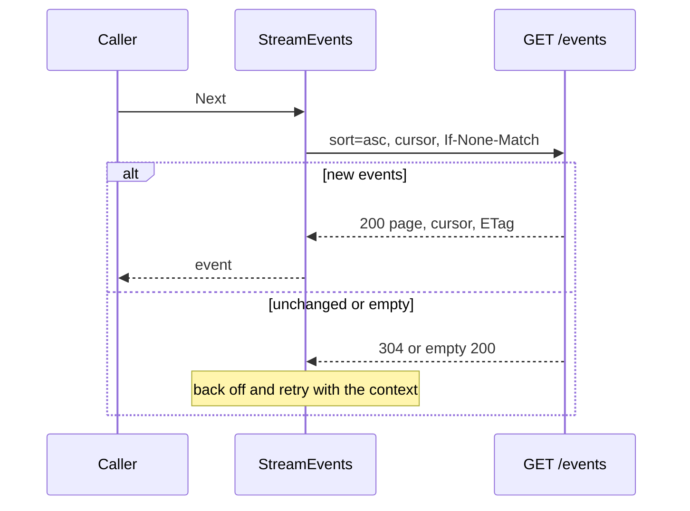

# Agents

Status: done

Owner: SDK maintainers

Package: `agents`

## 1. Purpose and scope

Wraps the Boat **Integrated agents** API for a running sandbox:

- queue a natural-language prompt and read its run status,
- list and long-poll sandbox events,
- list conversations,
- steer a turn that is already running,
- interrupt one conversation or the whole sandbox.

A sandbox runs many conversations in parallel, and each conversation runs one turn at a time. A
turn ends in `finished`, `failed` or `interrupted`. There is no completion webhook; callers poll the
prompt run or consume events.

Official reference: <https://docs.boat.dev/api/v1> and the Integrated agents guide linked from it.

## 2. Non-goals

- Sandbox lifecycle, files and commands. Those belong to `sandboxes`, `files` and `commands`.
- The provider-model catalog (`GET /provider-models`). It is not part of this service.
- Cross-domain flows such as create → prompt → wait → collect artifacts. Those belong in `jobs/`.
- An agent runtime, event store, deduplication layer or reconnecting supervisor. The SDK exposes
  the cursor and ETag; durable resume state is caller-owned.
- Dashboard configuration of provider credentials.

## 3. Public API

| Method | Signature | Notes |
|---|---|---|
| `Prompt` | `Prompt(ctx, sandboxID, PromptRequest, ...core.RequestOption) (*model.PromptResponse, error)` | `202`; queues work |
| `PromptStatus` | `PromptStatus(ctx, sandboxID, promptID, ...core.RequestOption) (*model.PromptRun, error)` | Single read |
| `WaitForPrompt` | `WaitForPrompt(ctx, sandboxID, promptID, WaitOptions) (*model.PromptRun, error)` | Polls until done |
| `Events` | `Events(ctx, sandboxID, EventsRequest, ...core.RequestOption) (*EventsPage, error)` | One page; supports ETag/304 |
| `StreamEvents` | `StreamEvents(ctx, sandboxID, EventsRequest, ...core.RequestOption) (core.Stream[model.SandboxEvent], error)` | Long-polls `/events` |
| `Conversations` | `Conversations(ctx, sandboxID) ([]model.Conversation, error)` | Most recent first |
| `Steer` | `Steer(ctx, sandboxID, SteerRequest) (*model.SteerResponse, error)` | Running turn only |
| `Interrupt` | `Interrupt(ctx, sandboxID, conversation string) (*model.SandboxActionResponse, error)` | Empty id interrupts all |

Services are safe for concurrent use. `Prompt`, `PromptStatus`, `Events` and `StreamEvents` accept
per-call request options such as `core.WithOrg`; `Conversations`, `Steer` and `Interrupt` use the
client-level organization only.

`StreamEvents` performs its first request before returning, so authentication, not-found and
transport errors surface from the constructor instead of the first `Next`. The returned stream is
not safe for concurrent `Next` calls, but `Close` may be called from another goroutine.

## 4. Types and aliases

| Public type | Underlying model | Notes |
|---|---|---|
| `PromptRequest` | — | Hand-written; omits unset optional fields |
| `EventsRequest` | — | Wire filters plus `ETag` and `PollInterval` |
| `EventsPage` | — | `Items`, `NextCursor`, `HasMore`, `ETag` |
| `SteerRequest` | — | Hand-written; string conversation id |
| `WaitOptions` | — | `PollInterval`, `Timeout` |
| `Prompt` result | `model.PromptResponse` | Includes `PromptID`, `ConversationID` and `PromptRun` |
| `PromptStatus` result | `model.PromptRun` | `Done` is the completion signal |
| `Events` items | `model.SandboxEvent` | Extensible, with `AdditionalProperties` |
| `Conversations` result | `[]model.Conversation` | |

`PromptRequest.Provider` uses `model.PromptRequestProvider`. An empty provider is omitted from the
body, which lets the dashboard selection apply. `Fast` is a `*bool`: nil omits the field, while
`core.Ptr(false)` explicitly forces standard speed. `New` and `ConversationID` are mutually
exclusive by API rule; the SDK does not enforce that locally.

## 5. Endpoints and mapping

| SDK method | HTTP | Path | Notes |
|---|---|---|---|
| `Prompt` | `POST` | `/sandboxes/{sandboxId}/prompt` | `202`; body is `PromptRequest` |
| `PromptStatus` | `GET` | `/sandboxes/{sandboxId}/prompts/{promptId}` | |
| `Events` | `GET` | `/sandboxes/{sandboxId}/events` | `limit`, `cursor`, `sort`, `type`, `conversation` |
| `StreamEvents` | `GET` | `/sandboxes/{sandboxId}/events` | Forces `sort=asc`, reuses cursor and ETag |
| `Conversations` | `GET` | `/sandboxes/{sandboxId}/conversations` | |
| `Steer` | `POST` | `/sandboxes/{sandboxId}/steer` | Conversation id in the body |
| `Interrupt` | `POST` | `/sandboxes/{sandboxId}/interrupt` | `conversation` query when set |

`Events` joins `EventsRequest.Type` with commas and repeats `conversation` for every conversation
id. `EventsRequest.ETag` is sent as `If-None-Match`. Cursors are treated as opaque strings and are
never decoded or built.

## 6. Error behavior

- `400 fast_mode_not_supported`, invalid model or malformed body: fix the request; terminal.
- `401 unauthorized`: missing or invalid key.
- `402 billing_required`: the account cannot prompt.
- `404 not_found`: unknown sandbox, prompt or conversation.
- `409 provider_not_configured`: terminal. Configure the provider in the dashboard first. The
  original `*core.APIError` is returned unchanged; `Details` may carry a setup URL, and the SDK
  never logs it. Look it up with `core.IsCode` or `errors.As`.
- `409 no_running_turn` from `Steer`: terminal for that call. `APIError.Details["reason"]` is one of
  `turn_ended`, `turn_not_started`, `no_turn`, `not_running` or `delivery_failed`. Queue work with
  `Prompt` for a new turn.
- `409` from `Interrupt`: surface the error; do not assume the work stopped.
- `429` and `503`: the transport retries safe GETs (`Events`, `PromptStatus`, `Conversations`) with
  jitter and `Retry-After`. It never auto-retries `Prompt`, `Steer` or `Interrupt`: a lost response
  may mean the work was already queued or delivered. Retry those only after checking state.
- No endpoint in this service uses `Idempotency-Key`; prompts are not deduplicated by the SDK.

A `304 Not Modified` is not an error. `Events` closes the empty body and returns an `EventsPage`
with no items and the same ETag, so a polling loop can continue.

## 7. Streaming and long-running behavior



- There is no SSE or WebSocket. Streaming is long polling of `GET /events`.
- Polls start about once per second. `EventsRequest.PollInterval` overrides that for tests and
  advanced callers.
- An empty page or `304` increases the delay exponentially up to 30 seconds (or 30 times the base
  interval when that is smaller). A page with events resets the backoff.
- `HasMore` pages with a cursor are fetched immediately; empty pages always wait, so a malformed
  response cannot spin the stream.
- `Next` returns `io.EOF` only after `Close`. Cancellation returns `context.Canceled` or
  `context.DeadlineExceeded`.
- `Close` is idempotent, holds no response body between polls, and stops a waiting `Next` or an
  in-flight poll.
- Resume state is the last cursor and ETag. The SDK keeps no durable state, so a restarted process
  can resume by passing `Cursor` and `ETag` to `StreamEvents`.
- `WaitForPrompt` polls `PromptStatus` every second by default until `Done` or a terminal status,
  the context ends, or `WaitOptions.Timeout` ends.

## 8. Examples

```go
// svc is *agents.Service. The root client wires it as client.Agents.
run, err := svc.Prompt(ctx, sandboxID, agents.PromptRequest{
    Provider: model.Codex,
    Prompt:   "Run the test suite, fix failures, and report the result.",
    New:      true,
})
if err != nil {
    return err
}

final, err := svc.WaitForPrompt(ctx, sandboxID, run.PromptID, agents.WaitOptions{})
if err != nil {
    return err
}
switch final.Status {
case model.PromptRunStatusFinished:
    // work is complete
case model.PromptRunStatusFailed, model.PromptRunStatusInterrupted:
    // inspect the events for the failure or interruption
}
```

Streaming:

```go
stream, err := svc.StreamEvents(ctx, sandboxID, agents.EventsRequest{
    Conversation: []string{conversationID},
    Type:         []string{"prompt", "response", "steer"},
})
if err != nil {
    return err
}
defer stream.Close()

for {
    event, err := stream.Next(ctx)
    if errors.Is(err, io.EOF) {
        return nil
    }
    if err != nil {
        return err
    }
    handle(event) // branch on event.Type; unknown types are valid
}
```

## 9. Testing notes

- `agents/prompt_test.go` covers the prompt body (provider, model, reasoning effort, fast, new,
  conversation id), `provider_not_configured`, status reads, polling and cancellation.
- `agents/events_test.go` covers every filter, `If-None-Match`/`304`, unknown event types and extra
  properties, and mapped error statuses.
- `agents/stream_test.go` covers cursor and ETag progression, immediate `HasMore` pages, `304`
  handling, cancellation while waiting, empty-page backoff, the first-fetch error, idempotent
  `Close` and `io.EOF`.
- `agents/control_test.go` covers conversations, steering, `no_running_turn`, and interrupt scoping.
- All tests use `httptest` through `internal/testutil` or a fake `core.Doer`; none call the live API.
- There is no live test for this service yet.

## 10. Open questions / known gaps

- The pinned OpenAPI spec has no `attachments` field on `POST /prompt`; attachments only appear in
  prompt event data. The SDK does not add an unsupported request field.
- `GET /provider-models` is not wrapped. Callers need the provider-model catalog outside this
  service for now.
- The root facade does not yet expose `Agents`; create the service with `agents.New` and the shared
  transport until the facade is wired.
- `Conversations`, `Steer` and `Interrupt` do not take per-call request options; use the client-level
  organization. Add options if a caller needs per-request organization scoping.
- `WaitForPrompt` uses wall-clock polling. It does not consume events and therefore cannot return
  the failure text from a `prompt` event; read events for diagnostics.
- If the API ever returns events without a `nextCursor`, the stream relies on the ETag and may
  repeat the last page once it changes. The current API supplies a cursor for long polling.
